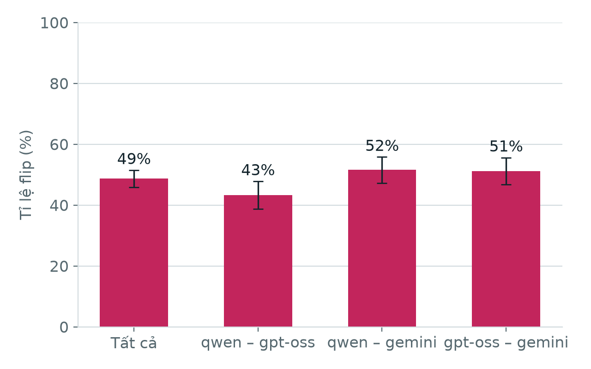
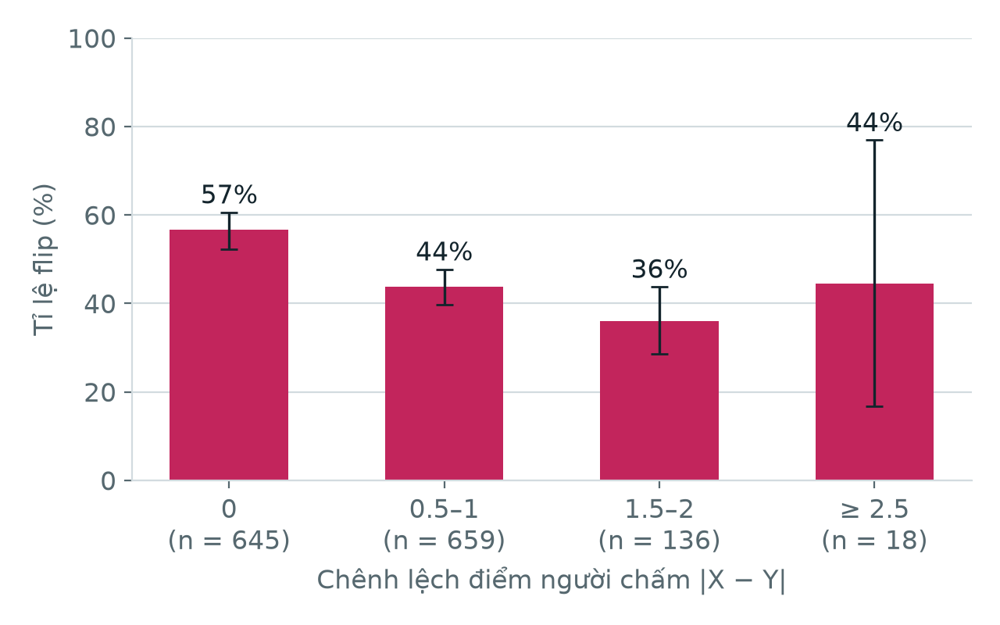
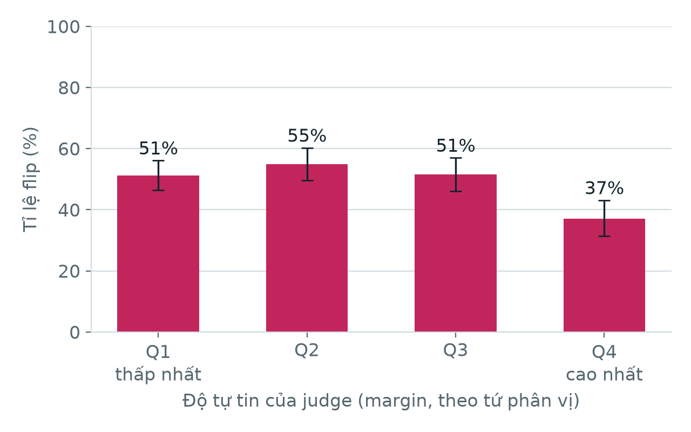
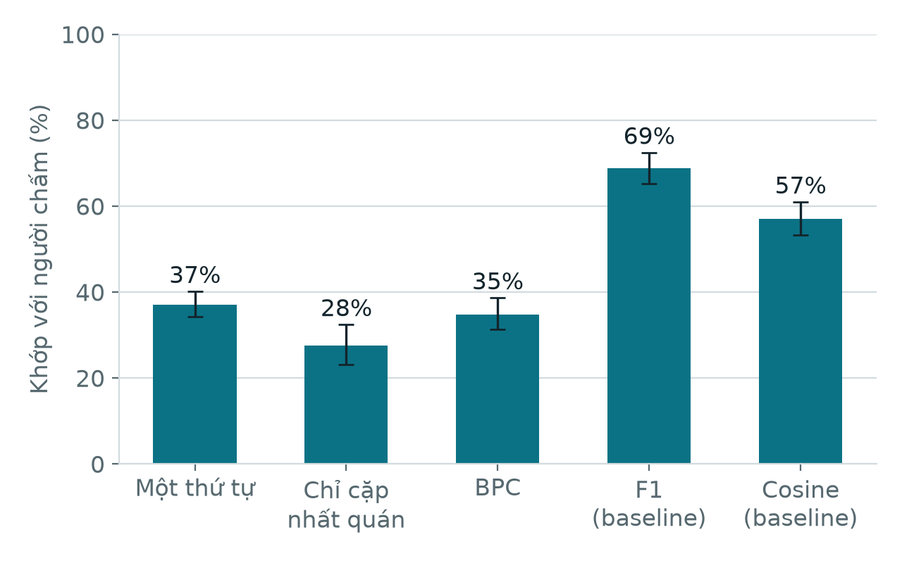

# Position Bias in LLM-as-a-Judge: Analysis and a Vietnamese Case Study

Final project report for NLP501.22 (Natural Language Processing).

- **Team:** ABNQ: Hồ Khắc Bắc, Đặng Thành Nhân, Nguyễn Việt Anh, Lê Trọng Quang
- **Lecturer:** Nguyễn Sĩ Thìn

## Abstract

Large language models (LLMs) are now widely used to grade the outputs of other LLMs. A known weakness of such judges is position bias: the verdict can change when only the order of the two answers changes. We measure this bias for Vietnamese. Three free models (Qwen2.5-7B-Instruct, gpt-oss-20b, Gemini Flash-Lite) answered 500 "why/how" questions from UIT-ViQuAD 2.0, giving 1,500 answer pairs. An open-weight judge, Qwen2.5-7B-Instruct, compared every pair in both orders with the MT-Bench pairwise prompt, and we read its verdict-token probabilities. Four annotators rated every answer on a 1-5 rubric (two ratings per answer; Krippendorff's α = 0.739, ordinal). The judge flipped its choice on 48.7% [45.9%, 51.5%] of pairs. The slot shown first won both runs in 42.5% of pairs, the second slot in only 6.2%. Flips were more common when annotators saw no quality difference (56.6%) than when the gap was 1.5-2 points (36.0%). The judge's confidence barely predicted flips (AUC 0.564). Agreement with the human winner stayed below 50% for every judge variant: 37.1% for a single order, 27.6% for consistent pairs only, and 34.8% after Balanced Position Calibration (BPC). A simple word-overlap F1 against the gold answer reached 68.9%. The judge also favoured gpt-oss and longer answers, while humans rated Gemini highest. Judging both orders removes position bias from the verdict, but it cannot repair a judge whose preference is misaligned with human ratings. For this 7B judge on Vietnamese, a gold-based lexical metric was the more reliable choice.

## 1 Introduction

### 1.1 Motivation

Grading open-ended answers by hand is slow and expensive. Since Zheng et al. [5], a common shortcut is to let a strong LLM act as the judge: it reads a question and two answers and says which is better. Surveys now treat "LLM-as-a-judge" as a field of its own [10].

A fair judge should pick the same answer no matter which one it reads first. In practice it often does not. On near-identical English answer pairs, Claude-v1, GPT-3.5 and GPT-4 keep their verdict after a swap in only 23.8%, 46.2% and 65.0% of cases [5, Table 2]. With ChatGPT as the judge, Vicuna-13B "beats" ChatGPT on 66 of 80 questions just by changing the order of the answers [6].

Human judges show order effects too, in song contests, figure skating and essay scoring [1, 2, 4]. Order matters most, for both humans and LLMs, when the two items are hard to tell apart. That shared condition does not imply a shared mechanism.

Almost all of this evidence is in English. Across 25 languages, LLM judges reach a Fleiss' kappa of only about 0.3 between languages, worst for low-resource ones [9]. We found no study that measures position bias on long Vietnamese answers against human ratings. This matters for anyone who wants to pick a free model for a Vietnamese product by letting an LLM rank the candidates: if the judge is position-biased, the ranking is wrong too.

### 1.2 Research questions

Each answer pair is judged twice. The answers are identical in both runs; only which one is shown first (as "A") changes. A *flip* is a pair where the winner in the first run differs from the winner in the second.

1. **RQ1.** How often does an LLM judge flip its verdict when the order of two Vietnamese answers is swapped?
2. **RQ2.** Are flips concentrated on pairs that human annotators rate as close in quality?
3. **RQ3.** Do flips coincide with low judge confidence, measured by the token probabilities the judge assigns to each verdict?
4. **RQ4.** Does judging in both orders and keeping only consistent verdicts improve agreement with human annotators?

The proposal also planned a secondary condition on an English translation of the same items. It was not run; we return to it in Section 7.

### 1.3 Contributions

- A position-bias measurement on 1,500 Vietnamese reading-comprehension answer pairs, each judged in both orders by an open-weight judge, with 95% bootstrap intervals over questions.
- A quality gap measured by **human ratings** (four annotators, two per answer), not by the judge itself, as in prior work [5, 6, 11].
- A test of whether the judge's own **token probabilities** predict flips, which closed-API judges in prior work could not provide.
- A test of two mitigations (consistent-only verdicts and BPC) against human ratings, with an honest negative result: neither brings the judge close to human agreement.
- Two practical observations: this 7B judge mostly writes its verdict *before* its explanation, despite the prompt, and it strongly prefers one model whose answers use bold formatting.

## 2 Related Work

### 2.1 Order effects in human judges

Jury scores in the Eurovision Song Contest and European figure skating rise with serial position, both when judges score at the end and when they score after each performance [1]. In a large English writing test in China (67,500 essays, 88 raters, 146,727 scores), a rater's score for an essay is pulled toward the score they gave the previous essay [2], consistent with Attali [4]. Proposed causes include impressions built up candidate by candidate [1], scale calibration along a series [3], and semi-automatic rating of similar essays [2, 4].

### 2.2 Biases of LLM judges

Zheng et al. [5] introduced MT-Bench and the pairwise judge prompt we reuse. They list four limitations of LLM judges: position, verbosity and self-enhancement bias, and weak grading of math and reasoning. On near-identical pairs, GPT-4 keeps its verdict after a swap in 65.0% of cases, and most judges lean toward the first slot [5, Table 2]. Bias is stronger on open questions: GPT-4's consistency is 42% on writing and 36% on humanities, but 86% on math and coding [5, Table 10]. On real model pairs, GPT-4's consistency rises from 67.5% to 98.8% as the quality gap grows [5, Table 11]. Without position bias in the picture, GPT-4 agrees with experts in 85% of non-tie votes, above the 81% agreement between experts [5, Table 5].

Wang et al. [6] define the Conflict Rate, the share of examples whose result changes when the order is swapped; it is our flip rate. On 80 Vicuna questions, GPT-4 conflicts on 46.3% of a close pair (Vicuna-13B vs ChatGPT) and 5.0% of a clear-gap pair (Vicuna-13B vs Alpaca-13B); ChatGPT conflicts on 82.5% and 52.5% [6, Table 2]. The two judges lean in opposite directions: GPT-4 favours the first slot and ChatGPT the second.

Shi et al. [11] give the most systematic study of position bias, with 15 judges. They show the bias is not random noise: strong judges have repetition stability above 0.85. Position bias is strongly affected by the quality gap between answers, its direction can change between tasks for the same judge, and answer length has only a weak effect. They also show that high position consistency does not guarantee fairness, so both consistency and direction should be reported.

Two lines of work suggest causes on the model side. Zheng et al. [7] show that LLMs answering multiple-choice questions have a prior preference for certain option ID tokens, such as "A". Liu et al. [8] show that models use information unevenly across positions in a long context. Zheng et al. [5] suggest the training data or the left-to-right causal architecture.

### 2.3 Mitigation

The simplest fix is to judge both orders. Zheng et al. [5, Sec. 3.4] use a *conservative swap*: an answer wins only if it wins in both orders; otherwise the pair is a tie. Wang et al. [6] propose three methods. Multiple Evidence Calibration (MEC) asks the judge to explain before it scores, since a model that scores first only rationalises its score. Balanced Position Calibration (BPC) averages each answer's score over both positions. Human-in-the-loop calibration sends the most uncertain examples to people. With GPT-4, MEC plus BPC raises kappa with human labels from 0.24 to 0.37, while the human-human kappa is 0.54 [6, Table 4].

### 2.4 Multilingual judges

Fu and Liu [9] find that LLM judges agree poorly across 25 languages (Fleiss' kappa about 0.3), worst for low-resource languages. This is the gap our study addresses for Vietnamese, with three differences from the work above: the quality gap comes from human ratings rather than from the judges [5, 6, 11]; the judge is open-weight, so its token probabilities are available; and every question has a gold answer from a reading-comprehension dataset.

## 3 Data and Method

### 3.1 Questions

We took 500 answerable questions (`is_impossible = false`) with their source passages from the train split of UIT-ViQuAD 2.0 [12]. No model is trained, so the train split is safe to use; the validation split has only 469 "why"/"how" questions on 318 passages. All 500 questions ask "why" or "how", so the answers are long enough to compare. We took at most one question per passage and 15 per article (108 articles), with a fixed seed.

### 3.2 Answer models

Three free models answered every question with the same prompt and temperature 0: Qwen2.5-7B-Instruct (4-bit AWQ, on a Colab T4), gpt-oss-20b (through Groq, low reasoning effort, final answer only) and Gemini Flash-Lite (`gemini-3.5-flash-lite`, Google AI Studio free tier). The prompt, in Vietnamese, asks for an answer based on the passage, in 2-4 sentences of plain prose, with no bullet points, headings or bold text. The three answers to a question form three pairs (Qwen-gpt-oss, Qwen-Gemini, gpt-oss-Gemini), 1,500 pairs in total.

Mean answer lengths were 52 words for Qwen, 74 for gpt-oss and 72 for Gemini. Despite the prompt, gpt-oss answers often use markdown bold (`**...**`). This matters later (Section 4.5).

### 3.3 Human annotation

Four annotators rated each answer on a 1-5 scale with a written rubric, blind to the source model and to the judge's verdict. Each question went to one of the six pairs of annotators, who both rated all three of its answers. Every answer therefore has two ratings, and each annotator rated about 750 answers. The sheets show the passage, the question, the gold answer and the model answer. Markdown emphasis was stripped from the sheets, because only one model used it and it would have revealed the model.

**Rubric summary.** The annotator first checks whether the answer contains the main point (what directly answers the question, usually the gold answer's idea), then whether the rest is true to the passage.

| Score | Meaning |
|---|---|
| 5 | Has the main point, and everything it says is in the passage. |
| 4 | Has the main point, but misses a small detail or adds one inference not in the passage. |
| 3 | Only part of the main point, or vague, or the main point plus one statement that contradicts the passage. |
| 2 | Misses the main point; only true side points. |
| 1 | Wrong, off-topic, made up, or the main point contradicts the passage. |

Extra content found in the passage costs nothing, however long. Content and not length or style is graded. When the gold answer is wrong, the annotator grades against the passage and flags the question; 14 flagged questions are excluded from all human-based criteria, leaving 1,458 pairs. The answer with the higher mean score is the *human winner*. Pairs with equal means (645 of 1,458) have no human winner.

**Agreement.** Table 1 shows that the rubric was usable as a reference.

*Table 1. Agreement between annotators.*

| Annotator pair | Answers | Cohen's κ | Quadratic κ |
|---|---|---|---|
| A+B | 252 | 0.700 | 0.772 |
| A+C | 252 | 0.615 | 0.735 |
| A+D | 249 | 0.617 | 0.782 |
| B+C | 249 | 0.648 | 0.756 |
| B+D | 249 | 0.758 | 0.822 |
| C+D | 249 | 0.649 | 0.708 |

Krippendorff's α over all four annotators is 0.739 (ordinal) and 0.760 (interval). Cohen's κ ranges from 0.615 to 0.758. For context, the three annotators of Wang et al. reached a kappa of 0.54 on win/tie/lose labels [6, Table 4], a different task and scale.

### 3.4 Judge

The judge is Qwen2.5-7B-Instruct (4-bit AWQ) run with vLLM on a Colab T4. Decoding is greedy (temperature 0), so a rerun gives the same verdict and repetition stability [11] is 1 by construction. Any flip is therefore caused by the order, not by sampling noise.

The prompt is the MT-Bench "pair-v2" system prompt, verbatim [5, Fig. 5]. It asks the judge to compare the two responses, give a short explanation, avoid position and length bias, and then output `[[A]]`, `[[B]]` or `[[C]]` (tie). The user message contains the passage, the question and the two raw answers. The judge does not see the gold answer.

Each pair (X, Y) is judged twice: in order "xy", X is Assistant A; in order "yx", Y is Assistant A. At the token that holds the verdict letter, we read the probabilities of `A`, `B` and `C` from the top-20 log-probabilities. We renormalise A and B to sum to 1 and map them back to X and Y. This gives p_x for each run, comparable across the two runs. In total there are 3,000 judgments.

Using probabilities also settles how ties are handled. A run whose text verdict is `[[C]]` still has a winner: the answer with the higher renormalised probability.

### 3.5 Metrics

All metrics follow the proposal and are defined in `experiment/analyze.py`.

*Table 2. Evaluation criteria.*

| Criterion | RQ | Definition |
|---|---|---|
| Flip rate | RQ1 | Share of pairs where the two runs pick different answers (winner of a run: X if p_x > 0.5). Equivalently, the same slot wins both runs. Same as the Conflict Rate of [6]. |
| First-Position Preference (FPP) | RQ1 | P(win \| first) − P(win \| second) = share of pairs where slot A wins both runs − share where slot B wins both. Positive means the first slot is favoured. |
| Human score gap | RQ2 | Mean annotator score of X − of Y; pairs binned by \|gap\|, flip rate per bin. |
| Confidence margin | RQ3 | \|p_x − p_y\| averaged over both runs; compared between flipped and consistent pairs, and summarised by an AUC. |
| Agreement with humans | RQ4 | Share of pairs with a human winner where the method picks that winner. Chance level is 50%. |
| Single order | RQ4 | Each run on its own; the mean of the two runs is reported. |
| Consistent only | RQ4 | Conservative swap [5]: keep only pairs where both runs agree; report coverage too. |
| BPC | RQ4 | X wins if the mean of p_x over both runs is above 0.5. Adapted from [6], which averages 1-10 scores, not probabilities. |
| Baselines | RQ4 | The answer with the higher word-overlap F1 (or higher sentence-embedding cosine, multilingual MiniLM) against the gold answer wins. |

All intervals are 95% bootstrap intervals with 2,000 replicates. We resample questions, not pairs, because the three pairs of one question share a passage and the annotators.

## 4 Results

All 3,000 judgments produced a valid verdict (0% format errors).

### 4.1 RQ1: How often does the judge flip?

*Table 3. Flip rate and direction (1,500 pairs).*

| Measure | Value |
|---|---|
| Flip rate | 48.7% [45.9%, 51.5%] |
| Flip rate, pairs with no tie verdict (n = 929) | 34.8% [31.3%, 38.3%] |
| Slot A (first) wins both runs | 42.5% [39.6%, 45.4%] |
| Slot B (second) wins both runs | 6.2% [4.7%, 7.8%] |
| First-Position Preference | +0.363 [+0.325, +0.399] |
| Verdict labels consistent (ties allowed) | 50.9% |
| Tie verdicts | 24.3% |
| Verdict written before the explanation | 85.5% |

*Table 4. Flip rate and FPP by model pair (500 pairs each).*

| Model pair | Flip rate | FPP |
|---|---|---|
| Qwen - gpt-oss | 43.2% [38.8%, 47.8%] | +0.268 [+0.212, +0.322] |
| Qwen - Gemini | 51.6% [47.2%, 55.8%] | +0.416 [+0.366, +0.466] |
| gpt-oss - Gemini | 51.2% [46.8%, 55.6%] | +0.404 [+0.350, +0.456] |

*Figure 1. Flip rate overall and by model pair, with 95% intervals.*

The judge flips on almost half of all pairs. The flips are not random in direction. In 42.5% of pairs the first slot wins both runs; in only 6.2% does the second slot win both. Put differently, when the judge flips, it is almost always because it picked whatever was shown first.

Ties do not explain the flips away. A quarter of the text verdicts are ties (24.3%). Among the 929 pairs where neither run said "tie", the judge still flips on 34.8%.

The Qwen-gpt-oss pair flips least (43.2%). This is also the pair where the judge has the clearest preference: it favours gpt-oss (Section 4.5). A strong preference for one answer leaves less room for the order to decide.

**The "explain first" assumption fails.** The MT-Bench prompt asks for an explanation before the verdict, and our design relied on that: a verdict that comes after reasoning should be less of a snap judgement, the idea behind MEC [6]. In practice, 85.5% of the 3,000 judgments put the verdict first and the explanation after it. For this 7B judge, the probabilities we read are mostly those of a verdict given before any reasoning.

### 4.2 RQ2: Are flips concentrated on close pairs?

*Table 5. Flip rate by absolute human score gap (1,458 pairs).*

| \|gap\| | Pairs | Flip rate |
|---|---|---|
| 0 | 645 | 56.6% [52.3%, 60.6%] |
| 0.5-1 | 659 | 43.7% [39.8%, 47.7%] |
| 1.5-2 | 136 | 36.0% [28.7%, 43.8%] |
| ≥ 2.5 | 18 | 44.4% [16.7%, 76.9%] |

*Figure 2. Flip rate by absolute human score gap.*

Yes, partly. Flips fall from 56.6% on pairs that humans rated equal to 43.7% at a gap of 0.5-1 and 36.0% at a gap of 1.5-2. The intervals of the first and third bins do not overlap. The last bin has only 18 pairs and a very wide interval, so it says little.

Two cautions. First, the decline is modest. Even on pairs with a clear human gap of 1.5-2 points, the judge flips on more than a third. In the English literature, GPT-4's flips almost vanish on clear-gap pairs (5.0% in [6]; 98.8% consistency in [5, Table 11]). Second, most pairs are close: 89% have a gap of 1 point or less, because annotators gave most answers a 4 or 5. The judge is therefore mostly asked to separate answers that humans also found hard to separate.

Answer length separates flips more sharply than human quality does. When the length difference between the two answers is above the median, the flip rate is 36.1% [32.4%, 40.0%]. At or below the median, it is 61.1% [57.3%, 64.6%]. The judge's decisions seem to follow surface differences it can see more than the quality differences humans see.

### 4.3 RQ3: Do flips coincide with low confidence?

*Table 6. Confidence margin for consistent and flipped pairs.*

| | Mean margin |
|---|---|
| Consistent pairs (n = 770) | 0.882 [0.870, 0.895] |
| Flipped pairs (n = 730) | 0.870 [0.857, 0.883] |
| Difference | 0.012 [−0.004, +0.029] |
| AUC (margin predicts consistency) | 0.564 |

*Table 7. Flip rate by margin quartile (375 pairs each).*

| Margin quartile | Flip rate |
|---|---|
| Q1 (0.03-0.80) | 51.2% [46.4%, 56.1%] |
| Q2 (0.80-0.96) | 54.9% [49.6%, 60.2%] |
| Q3 (0.96-0.996) | 51.5% [46.1%, 57.0%] |
| Q4 (0.996-1.00) | 37.1% [31.5%, 43.1%] |

*Figure 3. Flip rate by quartile of the judge's confidence margin.*

Barely. The judge is very confident almost all the time: the mean margin is about 0.87-0.88 for both groups, and the difference between them is not significant (its interval includes zero). An AUC of 0.564 is only slightly better than a coin toss (0.5) at telling a consistent pair from a flipped one.

The quartiles show the same picture. Flip rates in the three lower quartiles are all around 51-55%. Only in the top quartile, where the margin is above 0.996, does the flip rate drop, and even there 37.1% of pairs flip. The judge reverses its choice even when it puts more than 99.6% of the A/B probability on one answer. For this judge, a single run's token probability is not a usable warning signal.

This links to RQ1. The judge mostly states its verdict first, and a preference for the label it sees first (the first slot) would show up as high confidence in "A" in both orders. That is consistent with the label prior described by Zheng et al. [7], though our data cannot separate the slot from the label.

### 4.4 RQ4: Does judging both orders improve agreement with humans?

*Table 8. Agreement with the human winner (813 pairs with a human winner).*

| Method | Agreement |
|---|---|
| One order, X shown first | 29.6% [26.6%, 33.1%] |
| One order, Y shown first | 44.5% [40.9%, 48.3%] |
| One order (mean of both runs) | 37.1% [34.3%, 40.1%] |
| Consistent pairs only | 27.6% [23.1%, 32.4%] (coverage 57.6% [54.0%, 61.2%]) |
| BPC (average both orders) | 34.8% [31.3%, 38.6%] |
| Baseline: word-overlap F1 vs gold | 68.9% [65.3%, 72.4%] |
| Baseline: embedding cosine vs gold | 57.1% [53.3%, 60.9%] |

*Table 9. Agreement by model pair.*

| Model pair | Pairs | One order (mean) | BPC |
|---|---|---|---|
| Qwen - gpt-oss | 298 | 36.4% [32.1%, 40.8%] | 35.2% [29.7%, 40.8%] |
| Qwen - Gemini | 227 | 43.4% [38.7%, 48.1%] | 41.9% [35.7%, 48.6%] |
| gpt-oss - Gemini | 288 | 32.8% [29.3%, 36.8%] | 28.8% [23.9%, 34.1%] |

*Figure 4. Agreement with the human winner for each judge variant and the two baselines.*

No. This is a negative result, and the main finding of the project.

Every judge variant agrees with the human winner on fewer than half of the pairs. Because each pair has two possible winners, 50% is what a coin would score. The judge is not just noisy; it is systematically on the other side from the annotators.

Judging both orders does not help. BPC (34.8%) is no better than a single order (37.1%); the intervals overlap. Keeping only consistent verdicts is worse still: 27.6%, on 57.6% of the pairs. When this judge is consistent, it is consistently wrong by the human standard. Consistency removes the position effect, but what remains is the judge's own preference, and that preference runs against the annotators'.

The two single orders differ by 15 points (29.6% vs 44.5%). In our pair encoding, Y is always the later model in the list Qwen, gpt-oss, Gemini, and Gemini, the human favourite, is Y in two of the three pairs. The order that shows Y first agrees more, as a first-slot bias would predict. This also shows how much a single-order evaluation depends on an arbitrary choice of order.

The lexical baseline does much better. Picking the answer with the higher word-overlap F1 against the gold answer agrees with humans on 68.9% of pairs, and embedding cosine on 57.1%. This is not a fair fight: the baselines see the gold answer, and the judge does not. The annotators also saw the gold answer, and the rubric is built around it. Still, the practical lesson holds. When a gold reference exists, a cheap overlap metric tracked the human ratings far better than this LLM judge.

### 4.5 Model ranking

*Table 10. Model ranking by humans and by the judge (BPC).*

| Model | Human mean (1-5) | BPC win rate | Mean length (words) |
|---|---|---|---|
| Qwen | 4.52 | 35.7% | 52 |
| gpt-oss | 4.27 | 67.3% | 74 |
| Gemini | 4.82 | 47.0% | 72 |

Humans rank Gemini first, Qwen second and gpt-oss last. The BPC judge ranks gpt-oss first by a wide margin (67.3%), Gemini second and Qwen last. In head-to-head BPC verdicts, gpt-oss beats Gemini in 62.6% [58.2%, 66.6%] of pairs, although annotators rate Gemini about half a point higher on average. This pair also has the lowest BPC agreement with humans (28.8%, Table 9).

We see no sign of self-enhancement bias. The judge is a Qwen model, but it ranks Qwen's answers last (BPC win rate 35.7%).

Length explains part of the gap, but not all of it. BPC picks the longer answer in 69.2% [66.7%, 71.6%] of pairs with different lengths. This explains why the short Qwen answers lose. It does not explain the preference for gpt-oss over Gemini, whose mean lengths are almost equal (74 vs 72 words).

A likely confound is formatting. gpt-oss answers often use markdown bold, although the prompt asked for none. The judge saw the raw text with the bold markers. The annotators did not, because the sheets stripped emphasis to keep the model hidden. The judge and the annotators therefore did not grade exactly the same text. We did not test this directly; the check is to re-judge on emphasis-stripped text (Section 7).

### 4.6 Annotator agreement

Annotator agreement is substantial (Table 1): Cohen's κ 0.615-0.758 per pair, quadratic κ 0.708-0.822, and Krippendorff's α 0.739 (ordinal). So the human reference is reasonably stable. The judge's low agreement is not explained by the annotators disagreeing with each other. A remaining weakness is a ceiling effect: the mean score is above 4.2 for every model, and 645 of 1,458 pairs have no human winner.

## 5 Discussion

### 5.1 What the numbers mean

Picture a developer, Lan, who wants to pick the best free model for a Vietnamese help-desk bot. She asks the Qwen 7B judge to compare Gemini and gpt-oss answers, one order per question. Whatever she puts first wins far more often. If she judges both orders and averages (BPC), the order effect cancels out, and she gets a clean, stable verdict: gpt-oss wins. Her annotators would have told her the opposite.

Three findings combine into this picture.

1. **Position bias is large.** The judge flips on 48.7% of pairs, and the flips almost all favour the first slot. This is in the range reported for weaker English judges such as ChatGPT [6], not for GPT-4.
2. **Uncertainty is invisible.** The judge does not "know" when it is guessing. Its confidence is near 1 whether it flips or not (AUC 0.564). The cheap single-run signal we hoped for does not work for this judge.
3. **The remaining preference is misaligned.** BPC removes position bias from the verdict, but not the judge's other biases. What is left favours longer answers and gpt-oss, and agrees with humans less often than chance.

The order of these findings matters. Prior work treats position bias as the main threat and BPC as the fix [6]. Here, fixing position bias exposed a deeper problem. A consistent verdict is not a correct verdict.

We cannot say how much of this is due to Vietnamese and how much to the small judge. The English condition was not run, and the judge is a 7B model, far smaller than the GPT-4 judges in [5, 6]. The flip rate alone does not show a language effect.

The judge also did not follow the format it was given. It put the verdict first in 85.5% of judgments. Wang et al. [6] argue that a verdict given before reasoning is a snap judgement that the explanation then rationalises. If so, our judge mostly made snap judgements. This may be one reason why its confidence carries so little information.

### 5.2 Recommendations for LLM judges on Vietnamese

1. **Always judge both orders.** A single order is not just noisy; its result depends on which order was chosen (29.6% vs 44.5% agreement in our data). Report the flip rate and its direction (FPP) alongside any result.
2. **Validate against humans before trusting the judge.** Both-order judging only shows that the judge is consistent. A small human-rated sample (a few hundred pairs) is enough to see whether the judge agrees with people at all. Ours would have failed this check.
3. **Prefer a gold-based metric when one exists.** For reading comprehension with a reference answer, word-overlap F1 agreed with humans on 68.9% of pairs, against below 50% for the judge.
4. **Do not use single-run token probabilities as a trust signal** for a small judge. They were near 1 for flipped and consistent pairs alike.
5. **Check that the judge follows its output format.** Verify that the explanation really comes before the verdict, and parse the verdict wherever it appears.
6. **Give the judge and the humans the same text.** Formatting the annotators never see (here, bold) can drive the judge's choice.
7. **Control length.** Report how often the judge picks the longer answer. A length limit in the answer prompt was not enough: the judge picked the longer answer in 69.2% of pairs.

## 6 Limitations

- **One small judge.** We used only Qwen2.5-7B-Instruct, quantised to 4 bits. Larger or stronger judges may behave very differently. Our results describe this judge, not LLM judges in general.
- **No English condition.** The planned comparison with an English translation was not run, so we cannot attribute any effect to the language.
- **Different inputs for judge and annotators.** The annotators saw the gold answer and emphasis-stripped text; the judge saw neither the gold answer nor stripped text. Both differences may lower agreement. The first was a design choice (the judge setup follows MT-Bench); the second is a confound we found after the fact.
- **Ceiling effect.** Most answers scored 4 or 5, so 645 of 1,458 pairs have no human winner and 89% have a gap of at most 1 point. Agreement is measured on the 813 pairs with a human winner, which are often close.
- **Annotator independence.** The grading workbook was shared, and Google Sheets cannot hide one tab from one person. The team agreed to grade only their own tab, but annotators could see each other's scores. This may inflate the agreement in Table 1.
- **Annotator load.** Each annotator rated about 750 answers, so attention may have drifted over the grading period.
- **Probabilities and ties.** We read probabilities at the verdict token and renormalised A against B. A run with the text verdict "tie" still gets a winner from these probabilities. The flip rate on pairs with no tie verdict (34.8%) shows the finding does not depend on this choice.
- **Verdict before explanation.** Because the judge mostly gave the verdict first, our setup does not test the MEC idea of reasoning before judging, although the prompt asked for it.
- **Data contamination.** The questions come from a public train split that the answer models may have seen. This affects answer quality, not the flip measurement.
- **Free-tier model versions.** Gemini Flash-Lite on the free tier may change over time; we recorded the model id used (`gemini-3.5-flash-lite`).
- **Literature coverage.** Our search found no study of this bias against human ratings on long Vietnamese answers, but the search was not exhaustive.

## 7 Conclusion and Future Work

We measured position bias in an open-weight LLM judge on 1,500 Vietnamese answer pairs, against ratings from four annotators. The judge, Qwen2.5-7B, flipped on 48.7% of pairs, almost always toward the answer shown first. Flips were more common on pairs humans rated as equal, but persisted on clear-gap pairs. The judge's confidence barely signalled when it would flip. Judging both orders, with BPC or with consistent verdicts only, did not raise agreement with humans above 50%. A word-overlap F1 against the gold answer reached 68.9%. The judge also preferred gpt-oss and longer answers, while humans preferred Gemini.

Our answer to the open question of the proposal, "how can we tell when an LLM judge's verdict is trustworthy?", is therefore modest. Consistency across orders is necessary but not sufficient. The only check that caught the problem here was comparison with human ratings.

Future work:

1. **Re-judge on emphasis-stripped text**, so the judge sees exactly what the annotators saw. If the preference for gpt-oss drops, formatting was the confound.
2. **Run the English condition** on a translation of the same items, as planned, to separate language effects from judge effects.
3. **Try stronger judges**, including larger open-weight models, and compare their flip rates and human agreement on the same pairs.
4. **Enforce explanation first**, for example by parsing only a verdict after the explanation or by a two-step prompt, and test whether reasoning first changes the flip rate and the confidence signal.
5. **Give the judge the gold answer** (reference-guided judging [5]) to test whether the gap to the F1 baseline comes from missing information.
6. **Separate slot from label**, by renaming "A"/"B" as in [5], to test whether the first-slot preference is about position or about the token "A" [7].

## References

1. Bruine de Bruin, W. (2005). Save the last dance for me: unwanted serial position effects in jury evaluations. Acta Psychologica 118(3), 245-260. doi:10.1016/j.actpsy.2004.08.005
2. Zhao, H., Andersson, B., Guo, B., & Xin, T. (2017). Sequential Effects in Essay Ratings: Evidence of Assimilation Effects Using Cross-Classified Models. Frontiers in Psychology 8:933. doi:10.3389/fpsyg.2017.00933
3. Unkelbach, C., Ostheimer, V., Fasold, F., & Memmert, D. (2012). A calibration explanation of serial position effects in evaluative judgments. Organizational Behavior and Human Decision Processes 119, 103-113.
4. Attali, Y. (2011). Sequential effects in essay ratings. Educational and Psychological Measurement 71, 68-79. doi:10.1177/0013164410387344
5. Zheng et al. Judging LLM-as-a-Judge with MT-Bench and Chatbot Arena. NeurIPS 2023 Datasets and Benchmarks. arXiv:2306.05685
6. Wang et al. Large Language Models are not Fair Evaluators. 2023. arXiv:2305.17926
7. Zheng et al. Large Language Models Are Not Robust Multiple Choice Selectors. ICLR 2024. arXiv:2309.03882
8. Liu et al. Lost in the Middle: How Language Models Use Long Contexts. TACL. arXiv:2307.03172
9. Fu and Liu. How Reliable is Multilingual LLM-as-a-Judge? Findings of EMNLP 2025. arXiv:2505.12201
10. Gu et al. A Survey on LLM-as-a-Judge. arXiv:2411.15594
11. Shi, L., Ma, C., Liang, W., Diao, X., Ma, W., & Vosoughi, S. (2024). Judging the Judges: A Systematic Study of Position Bias in LLM-as-a-Judge. arXiv:2406.07791 (v9)
12. Nguyen, K. V., Tran, S. Q., Nguyen, L. T., Huynh, T. V., Luu, S. T., & Nguyen, N. L.-T. (2022). VLSP 2021 - ViMRC Challenge: Vietnamese Machine Reading Comprehension. arXiv:2203.11400. Dataset: https://huggingface.co/datasets/taidng/UIT-ViQuAD2.0
